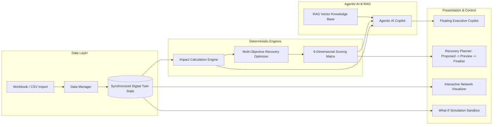

# ChainTwin AI — Autonomous Supply Chain Digital Twin Recovery Agent

> **Hackathon Theme:** AI for Business  
> **Domain:** Supply Chain Digital Twin & Network Optimization  
> **Core Technologies:** Autonomous Agentic AI, Deterministic Digital Twin, Multi-Objective Optimization, RAG Vector Search  

---

## 1. Executive Summary

**ChainTwin AI** is an enterprise-grade autonomous supply chain digital twin recovery agent. Modern supply chains are fragile, linear networks where unexpected disruptions—such as factory strikes, machinery outages, climate hazards, or transportation bottlenecks—cascade into massive stockouts, violated SLAs, and devastating financial penalties.

ChainTwin AI builds a live, real-time mirror of the physical supply network across all six echelons:
$$\text{Supplier} \longrightarrow \text{Material} \longrightarrow \text{Factory} \longrightarrow \text{Distribution Centre} \longrightarrow \text{Store} \longrightarrow \text{Customer}$$

When a supply disruption occurs, ChainTwin AI deterministically traces propagation paths, projects inventory depletion day-by-day, computes delivery breaches, synthesizes candidate recovery strategies (internal shifts vs. qualified Tier-2 backup procurement), scores them across 6 business dimensions, and assists supply chain managers with explainable AI grounded in contract policies.

---

## 2. Hackathon Evaluation Dimensions

| Dimension | Implementation in ChainTwin AI |
|---|---|
| **Disruption Detection** | Multi-modal intake (structured parameters & natural language NLP parser) + early-warning signals for overdue stages, buffer drops, and supplier drifts. |
| **Dependency Reasoning** | Deterministic traversal of BOM trees and multi-echelon transit paths. Proves which orders remain strictly **SAFE** (e.g. materials already received) versus at risk. |
| **Recovery-Plan Diversity** | Generates materially distinct strategies: **Baseline (Do Nothing)**, **Plan A (Multi-objective optimal)**, **Plan B (Zero-procurement internal shift)**, and **Plan C (Expedited express recovery)**. |
| **Optimization Quality** | Constrained multi-objective ranking evaluating supplier capacity, lead times, transit CO2, and inventory balance, completely avoiding phantom solutions. |
| **Adaptability** | Real-time weight tuning sliders for 6 dimensions; instant recalculation; temporal date rebasing to today's date; dynamic schema-driven data manager. |
| **Business Impact** | Explicit quantification of protected order count, customer penalty avoidance (INR), recovery time (days), and net financial benefit. |

---

## 3. System Architecture & Topology



---

## 4. Key Architectural Capabilities

### 4.1 Deterministic Calculation vs AI Reasoner Separation
- **The AI never fabricates numbers:** Quantities, stock levels, lead times, prices, and penalty figures are computed exclusively by a deterministic calculation engine.
- **AI Role:** Grounded in mathematical calculation outputs and RAG contract retrieval, explaining trade-offs, answering queries, drafting RFQ communications, and citing policies.

### 4.2 Known vs Assumption Guardrails
- **KNOWN:** Confirmed records from uploaded database sheets or manager-approved contracts.
- **ASSUMPTION:** Unconfirmed quotes, estimated lead times, or unapproved material substitutions. Displayed with an **amber dotted underline** and popup audit badge.

### 4.3 Proposed $\rightarrow$ Previewed $\rightarrow$ Finalised Workflow
1. **Proposed:** Candidate strategies evaluated mathematically.
2. **Previewed:** Strategy mapped visually on the network graph with **dashed teal edges** without modifying live database state.
3. **Finalised:** Applied to production records with immutable audit logs and one-click **Undo** capability.

### 4.4 Live vs. What-If Simulation Isolation
- Simulation mode runs in a deep-copy sandbox. Live records are completely isolated until explicitly promoted via **"Report This as Real"**.

---

## 5. Technology Stack

- **Frontend:** React 18, TypeScript, Tailwind CSS, Lucide Icons, Canvas & SVG Graph Topologies.
- **State & Cross-Tab Sync:** Reactive React Context with `BroadcastChannel` synchronization.
- **Data & Excel Processing:** SheetJS (`xlsx`) multi-sheet workbook parsing & schema generator.
- **Backend API:** Node.js, Express, `tsx`.
- **RAG & Search:** Vector semantic chunking (~500 tokens, 50-token overlap) with BM25 / TF-IDF cosine ranking.
- **Test Suite:** Native Node.js Test Runner (`node:test`).

---

## 6. Folder Structure

```
chaintwin-ai/
├── public/
│   └── sample/
│       └── tiruppur_tshirt_supply_chain_data.xlsx  # 15-sheet Excel dataset
├── server/
│   └── index.ts                                   # Express API endpoints
├── src/
│   ├── components/
│   │   ├── alerts/AlertsAndHistory.tsx            # Early warnings & audit trail
│   │   ├── auth/AuthPage.tsx                      # Split-screen authentication
│   │   ├── backups/BackupSuppliersPage.tsx        # Tier-2 matrix & RFQ drafter
│   │   ├── common/                                # Badge, CommandPalette, ReportModal
│   │   ├── dashboard/LiveDashboard.tsx            # Main Command Centre & KPIs
│   │   ├── datamanager/DataManager.tsx            # Generic schema-driven CRUD
│   │   ├── layout/                                # Sidebar & TopNav
│   │   ├── network/NetworkGraph.tsx               # Interactive SVG network topology
│   │   ├── recovery/RecoveryPlanner.tsx           # 6D plan optimizer & approval
│   │   └── simulation/WhatIfSimulator.tsx         # What-If time travel sandbox
│   ├── context/                                   # Auth, TwinData, Notifications
│   ├── data/seedData.ts                           # Tiruppur dataset JSON seed
│   ├── engine/                                    # Calculation, Optimizer, RAG, Rebasing
│   ├── services/aiService.ts                      # Agentic tools & NLP parser
│   ├── types/index.ts                             # TypeScript interfaces & schemas
│   ├── App.tsx                                    # Master layout router
│   └── main.tsx
├── tests/
│   └── engine.test.ts                             # Unit test suite
├── package.json
├── tsconfig.json
└── vite.config.ts
```

---

## 7. Prerequisites & Installation

### Prerequisites
- Node.js `v18.0.0` or higher
- npm `v9.0.0` or higher

### Installation Steps
```bash
# Clone the repository
git clone <repo-url>
cd chaintwin-ai

# Install dependencies
npm install

# Start development servers (Vite client on port 5173 + Express API on port 3001)
npm run dev
```

Open your browser at: **`http://localhost:5173`**

---

## 8. Five-Minute Hackathon Demonstration Script

1. **Sign In:**
   - On the split-screen landing page, click **"One-Click Hackathon Demo Login"** to immediately enter the Command Centre.
2. **Observe Healthy Network:**
   - Review the live topology: Supplier $\to$ Material $\to$ Factory $\to$ DC $\to$ Store $\to$ Customer.
   - Note that before a disruption is reported, all KPIs are green/blue with 0 late orders and ₹0 penalties.
3. **Report Tier-1 Disruption:**
   - Click **"Report Disruption Event"**.
   - Type or paste: *"Sri Kumaran Spinning Mills will experience a complete shutdown for 10 days starting tomorrow."*
   - Click **"Parse"** to see AI map it to `SUP-01`, `10 Days`, `100% loss`, then click **"Submit & Calculate Impact"**.
4. **Inspect Dependency Cascading:**
   - Notice immediate updates: Unit 1 stocks out in 2.4 days; 3 festive customer orders (Madras Mart, Hyderabad Hues) face delivery breaches totaling ₹148,000 in contractual late penalties.
   - Click on `ORD-1001`: notice it is marked **SAFE** because its `Material Received` stage was already completed!
5. **Optimize Recovery Strategies:**
   - Navigate to the **Recovery Planner**.
   - Compare **Plan A (Balanced Optimal)** vs **Plan B (Low-Cost Internal Reallocation)** vs **Do Nothing**.
   - Adjust the **Weight Sliders** (e.g. increase SLA weight to 60%) to observe real-time candidate re-ranking.
   - Click **"Why This Plan?"** to read grounded citations from `Customer_SLA_and_Penalty_Policy.pdf`.
6. **Preview & Finalise:**
   - Click **"Preview Changes on Network"**: observe **dashed teal recovery routes** appear on the topology.
   - Click **"Finalise Strategy to Live"** to execute recovery. Confirm order statuses recover.
7. **Verify Audit Trail & Undo:**
   - Navigate to **Alerts & History** to view the immutable audit record. Click **"Undo Previous Action"** to demonstrate instant rollback.
8. **Export Executive Briefing:**
   - Click **"Executive Report"** in the top navigation to view and print the PDF-ready briefing report.

---

## 9. Licence
MIT License. Built for the **AI for Business Hackathon**.

